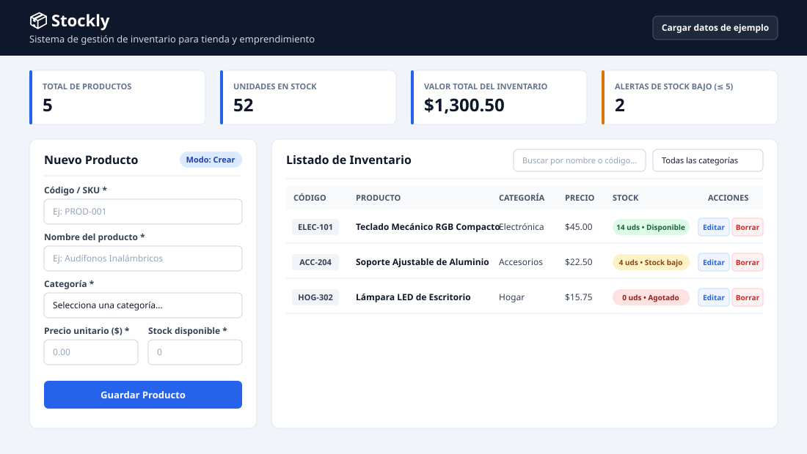
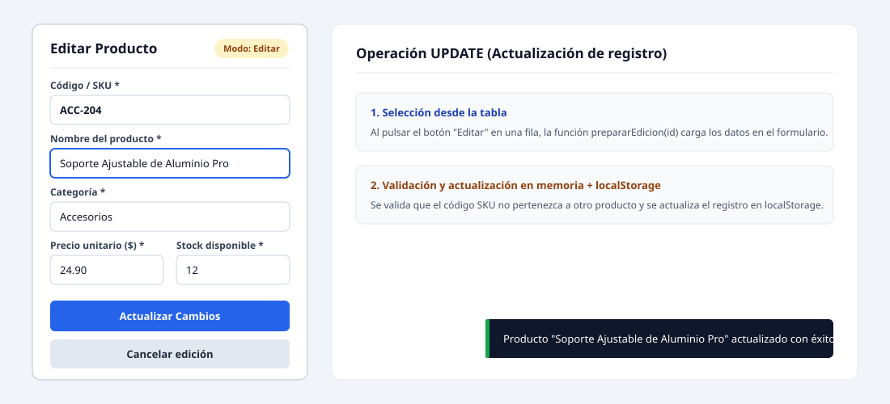
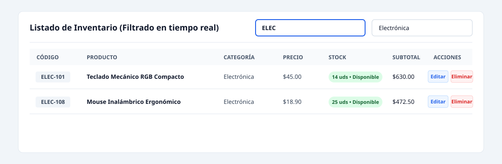

# 📦 Stockly - Aplicación Web CRUD de Inventario

## 1. Nombre del proyecto
**Stockly** — Sistema web CRUD para el control y gestión de inventario de productos en una tienda o emprendimiento.

---

## 2. Descripción breve
**Stockly** es una aplicación web sencilla desarrollada como trabajo práctico para el seminario **Gestión de Software Ágil asistido por Inteligencia Artificial**. Su objetivo es administrar el catálogo de productos de un negocio permitiendo realizar las cuatro operaciones fundamentales de persistencia de datos (**CRUD**):

- **Create (Crear):** Registrar nuevos productos indicando su código SKU, nombre, categoría, precio unitario y cantidad disponible en stock.
- **Read (Leer):** Visualizar todos los productos registrados en una tabla dinámica, consultar indicadores generales (total de productos, unidades, valor del inventario y alertas de stock bajo) y filtrar en tiempo real por texto o categoría.
- **Update (Actualizar):** Seleccionar cualquier producto de la tabla para cargar sus datos en el formulario, modificar su información (como cambios de precio o ajuste de unidades) y guardar los cambios.
- **Delete (Eliminar):** Dar de baja productos del inventario con confirmación previa para evitar borrados accidentales.

Toda la información se almacena de forma local en el navegador mediante `localStorage`, por lo que los datos se conservan aunque se recargue la página o se cierre la pestaña, sin necesidad de configurar un servidor externo.

---

## 3. Tecnologías utilizadas

| Componente | Tecnología | Uso en el proyecto |
| :--- | :--- | :--- |
| **Estructura** | HTML5 | Maquetación semántica del panel de resumen, formulario de registro/edición y tabla de datos. |
| **Estilos y Diseño** | CSS3 | Diseño responsivo con CSS Grid y Flexbox, variables de color, etiquetas de estado de stock y notificaciones. |
| **Lógica cliente** | JavaScript (ES6+) | Manipulación del DOM, validaciones del formulario, funciones del CRUD y filtros de búsqueda. |
| **Persistencia de datos** | `localStorage` | Almacenamiento de los registros en formato JSON directamente en el navegador. |
| **Asistencia de desarrollo** | Inteligencia Artificial | Generación iterativa de la estructura base, funciones del CRUD y refactorización de validaciones. |

---

## 4. Estructura del proyecto

```text
stockly/
├── index.html                        # Interfaz principal de la aplicación
├── css/
│   └── styles.css                    # Hojas de estilo y diseño responsivo
├── js/
│   └── app.js                        # Lógica del CRUD y manejo de localStorage
├── assets/
│   └── screenshots/                  # Capturas de pantalla del funcionamiento
│       ├── 01-vista-general.svg
│       ├── 02-modo-edicion.svg
│       └── 03-filtro-busqueda.svg
└── README.md                         # Documentación del proyecto y registro de prompts
```

---

## 5. Instrucciones para ejecutar el proyecto

La aplicación no requiere instalar dependencias ni servidores complejos:

1. **Clonar o descargar el repositorio:**
   ```bash
   git clone https://github.com/valerieet91/Inventario.git stockly
   cd stockly
   ```
2. **Abrir la aplicación:**
   - Haz doble clic directamente sobre el archivo `index.html` para abrirlo en cualquier navegador web moderno (Google Chrome, Microsoft Edge, Firefox, etc.).
   - Opcionalmente, si usas **Visual Studio Code**, puedes abrirlo con la extensión **Live Server** haciendo clic derecho en `index.html` -> *"Open with Live Server"*.
3. **Probar el CRUD:**
   - Al abrir la app por primera vez, se cargan automáticamente 5 productos de prueba.
   - También puedes usar el botón **"Cargar datos de ejemplo"** en la esquina superior derecha para restaurar los datos iniciales cuando quieras.

---

## 6. Capturas de pantalla

### Vista general del inventario y panel de indicadores (Create & Read)


### Edición de un producto existente (Update)


### Búsqueda y filtrado por categoría en tiempo real (Read & Delete)


---

## 7. Lista de prompts utilizados en el desarrollo

El desarrollo se realizó de manera progresiva, empezando por una estructura básica funcional y pidiendo ajustes conforme iba probando la página en el navegador.

---

### Prompt 1: Estructura base en HTML para el inventario
> **Prompt enviado:**
> *"Hola, necesito hacer una aplicación web sencilla para un trabajo de la universidad que sea un CRUD de inventario de productos de una tienda usando solo HTML, CSS y JavaScript con localStorage. Para empezar ayúdame solo con el código HTML que tenga un formulario para agregar productos (código, nombre, categoría, precio y stock) y al lado una tabla donde se vayan a mostrar los registros con botones de editar y eliminar."*

- **¿Qué pedí y para qué?**
  Pedí únicamente el esqueleto en HTML5 para tener clara la distribución de los campos del formulario y las columnas de la tabla antes de meterme con el diseño o la lógica en JavaScript.

---

### Prompt 2: Lógica inicial en JavaScript para Crear y Listar (Create y Read)
> **Prompt enviado:**
> *"Con base en ese HTML, ahora ayúdame a hacer el archivo app.js para que cuando llene el formulario y le dé al botón de guardar, el producto se agregue a un arreglo, se guarde en el localStorage y se dibuje en la tabla. También necesito que cuando recargue la página se lean los datos que ya estaban guardados en localStorage para que no se borren."*

- **¿Qué pedí y para qué?**
  Solicité las dos primeras funciones del CRUD (**Create** y **Read**) junto con la conexión a `localStorage`. Con esto pude probar por primera vez que el formulario guardara datos reales y se mantuvieran al refrescar el navegador.

---

### Prompt 3: Completar el CRUD con las funciones de Editar y Eliminar (Update y Delete)
> **Prompt enviado:**
> *"Ya me guarda y me muestra los productos en la tabla, pero ahora necesito que funcionen los botones de Editar y Eliminar de cada fila. Quiero que al darle a Editar se suban los datos de ese producto al mismo formulario para modificarlos y guardar los cambios, y que haya un botón para cancelar si me arrepiento de editar. Y para el botón de Eliminar, que primero pregunte con un confirm si estoy seguro antes de borrarlo."*

- **¿Qué pedí y para qué?**
  Pedí implementar las operaciones **Update** y **Delete** reutilizando el mismo formulario mediante un campo oculto (`productId`). Además, pedí un botón para cancelar la edición y una alerta de confirmación al eliminar para no borrar registros por error.

---

### Prompt 4: Validaciones del formulario y evitar códigos repetidos (Refactorización)
> **Prompt enviado:**
> *"Probando la página me di cuenta de que si pongo un código de producto que ya existe me deja guardarlo repetido, o si dejo espacios en blanco. Ayúdame a mejorar la validación en JavaScript para que revise que el precio sea mayor a 0, el stock no sea negativo y que no deje registrar dos productos con el mismo código SKU (teniendo en cuenta que cuando estoy editando un producto sí me deje guardar su propio código)."*

- **¿Qué pedí y para qué?**
  Después de probar el CRUD básico noté problemas con datos duplicados o vacíos. Usé este prompt para refactorizar la lógica de envío del formulario y añadir reglas de validación más realistas para un inventario.

---

### Prompt 5: Buscador, filtro por categoría y tarjetas de resumen
> **Prompt enviado:**
> *"Para que la aplicación quede más completa, quiero agregarle arriba unas tarjetas que muestren cuántos productos hay en total, el valor total del inventario (multiplicando precio por stock) y cuántos productos tienen stock bajo (5 o menos unidades). También ayúdame a poner arriba de la tabla un buscador por nombre o código y un select para filtrar por categoría sin que se dañe lo que ya tenemos."*

- **¿Qué pedí y para qué?**
  Quise personalizar el proyecto para que no fuera solo una tabla básica. Con este prompt agregué indicadores de negocio útiles para una tienda y mejoré la operación **Read** con búsqueda y filtrado en tiempo real.

---

### Prompt 6: Mejora del diseño visual en CSS y etiquetas de estado
> **Prompt enviado:**
> *"Ahora ayúdame a mejorar el archivo styles.css para que la página se vea limpia y moderna, poniendo el formulario a la izquierda y la tabla a la derecha en pantallas grandes, pero que en celular se acomode uno debajo del otro. También quiero que en la columna de stock se vea una etiqueta de color: verde si hay buen stock, amarilla si quedan 5 o menos, y roja si está en 0 (agotado)."*

- **¿Qué pedí y para qué?**
  Pedí organizar la hoja de estilos usando CSS Grid, definir una paleta de colores profesional y añadir indicadores visuales (badges) en la columna de stock para identificar rápidamente qué productos están por agotarse.

---

### Prompt 7: Comentarios explicativos y botón de datos de prueba
> **Prompt enviado:**
> *"Por último, ayúdame a organizar mejor el código de app.js separándolo por secciones con comentarios claros para cada parte del CRUD (Create, Read, Update, Delete), y agrega un botón en el encabezado que cargue unos 5 productos de ejemplo para poder hacer la demostración más rápido en el video."*

- **¿Qué pedí y para qué?**
  Solicité limpiar y documentar el código fuente para que fuera fácil de leer y explicar durante la sustentación en video, además de incluir una función de carga rápida de datos de prueba.

---

## 8. Personalizaciones y ajustes propios realizados al código

Para asegurar la calidad del proyecto y adaptarlo con criterio propio:
1. **Separación clara de responsabilidades:** Se organizó el código en carpetas (`css/styles.css` y `js/app.js`) y se dividió `app.js` en 7 bloques comentados para identificar de inmediato dónde ocurre cada acción del CRUD.
2. **Retroalimentación visual (Toast y Badge de modo):** En lugar de usar alertas invasivas (`alert()`) cada vez que se guarda o edita un producto, se implementó una notificación flotante discreta en la esquina inferior derecha y una etiqueta en el formulario que cambia entre **"Modo: Crear"** y **"Modo: Editar"**.
3. **Protección al eliminar durante una edición:** Se agregó una validación extra en `eliminarProducto()` para que, si el usuario elimina justo el producto que tenía cargado en el formulario de edición, el formulario se limpie automáticamente y no quede en un estado inconsistente.
